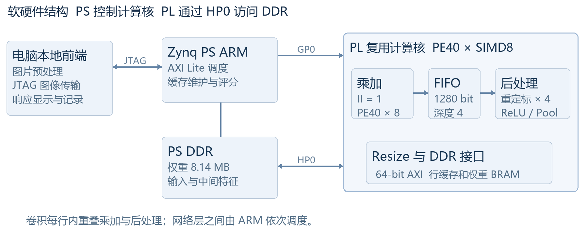
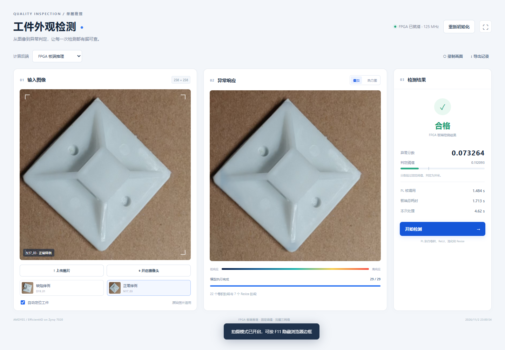
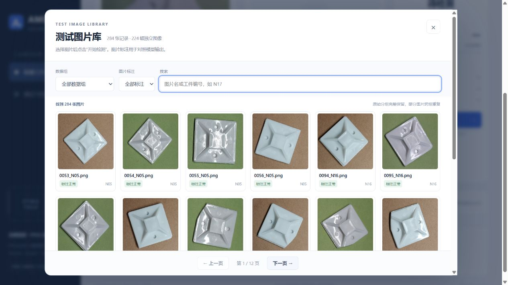

# 基于 Zynq-7020 的工业视觉异常检测系统

**工业异常检测 · INT8 量化加速 · 流水线协同优化**

本项目面向扎带固定座等工件的外观缺陷检测，基于 EfficientAD 构建工业视觉异常检测系统，并在 Zynq-7020 平台完成 Teacher、Student 与 Autoencoder 三个网络的 INT8 推理部署。系统采用 PS–PL 协同架构，由可复用 FPGA 计算核执行网络计算，ARM 处理器负责调度与异常评分，上位机提供图像输入、异常响应可视化和检测记录管理。

项目已完成计算核仿真、布局布线时序核验、完整模型板级对照及图像检测演示。当前成果以功能正确性、资源约束下的加速实现和可复现验证为重点；识别有效性及其适用边界在下文单独列示。

**团队：AMDYES　｜　赛道：AMD 自主选题　｜　开发工具：Vivado / Vitis 2025.2**

## 评审资料索引

| 资料 | 内容 |
|---|---|
| [设计报告 PDF](report/design_report_draft.pdf) · [可编辑版本](report/design_report_draft.docx) | 研究背景、技术方案、软硬件划分、实现结果与分析；当前为报告初稿 |
| [准确率评估](report/accuracy_evaluation.md) | 四组图像的 FP32 / INT8 指标、数据来源及误报分析 |
| [复现说明](report/reproduction.md) | 环境配置、源码构建、预编译产物检查与板级运行 |
| [通用 Skill](skill/README.md) · [AI 协作记录](report/ai_collaboration.md) | 可迁移的验证流程、辅助脚本、失败案例与协作过程 |
| [要求对照](report/contest_compliance.md) · [演示视频脚本](report/video_script.md) | 赛事条款对应、待完善事项及演示流程 |

## 系统架构



| 层级 | 主要职责 | 实现方式 |
|---|---|---|
| FPGA 可编程逻辑（PL） | 卷积、重定标、ReLU、平均池化与双线性 Resize | 单个可复用 HLS 计算核，按网络层配置执行；PE40 × SIMD8，125 MHz |
| ARM 处理系统（PS） | 网络层调度、DDR 缓冲区与缓存维护、异常评分及阈值判定 | Cortex-A9 standalone 应用；AXI-Lite 控制、HP0 数据访问 |
| 上位机 | 图像预处理与传输、检测操作、响应图显示和记录导出 | 本地 Web 前端；JTAG 与板端服务通信 |

完整推理链包含 **22 个卷积阶段及相应的激活/池化处理、7 个 Resize 阶段**。三个网络逐层复用同一计算核，在器件资源限制下完成完整网络计算；最终异常评分由 PS 执行。

## 技术特点

1. **面向完整模型的资源复用架构。** 将不同网络层映射到统一计算接口，通过层参数配置和片上数据复用，支持 Teacher、Student 与 Autoencoder 的计算需求。
2. **乘加与后处理协同流水。** 将卷积乘加和重定标、激活、池化划分为生产者与消费者任务，通过片上 FIFO 实现行内计算重叠。在保持模型、量化参数及并行度不变的条件下，核调用时间由约 1.787 s/图降至 1.484 s/图，减少约 17.0%。
3. **计算、接口与时序联合优化。** 结合地址通路、存储访问、控制扇出和流水级划分进行优化，并通过布线后时序及板上时钟读回确认 125 MHz 工作状态。
4. **可追溯的验证与工程交付。** 对源码、模型、输入、RTL、IP 和板端产物建立身份清单，将数值正确性、硬件实现、真实板测和识别效果分别验证，并提炼为通用 Skill。

当前 HLS 源码入口为 [`efficientad_engine.cpp`](src/accelerator/hls/efficientad_engine.cpp)。硬件集成复用 PS7、AXI SmartConnect、Processor System Reset 等现成 IP；FINN 辅助库的使用范围与许可说明见[第三方来源](report/sources.md)。

## 实现结果

### 性能与时序

| 指标 | 实测结果 | 测量范围或证据 |
|---|---:|---|
| PL 工作频率 | 125 MHz | 布线后时钟约束与 SLCR 寄存器读回 |
| 完整模型 PL 核调用合计 | 约 1.484 s/图 | 固定输入的各层核调用时间之和 |
| 演示服务板端总时间 | 约 1.713 s/图 | 网络计算、板端调度、缓存维护及评分；省略逐层 CRC 自检 |
| 完整模型自检总时间 | 约 2.028 s/图 | 包含逐层 CRC 校验的自检程序 |
| 单核 ARM NEON 基线 | 约 32.157 s/图 | 本工程的单核算子实现与同组固定输入 |
| 相对上述 ARM 基线的核调用加速比 | 约 21.68× | 32.157 s / 1.484 s |
| Setup / Hold 裕量 | WNS +0.175 ns / WHS +0.038 ns | 125 MHz 布线后时序报告 |

核调用时间与板端总时间采用不同计时边界，分别列示。图像预处理、JTAG 下载与传输、浏览器显示等主机开销不计入 PL 核调用时间；演示界面的“本次处理”另行记录完整请求耗时。ARM 对比对应本工程的特定实现，不代表各类 CPU 推理框架的性能上限。

### 器件资源

工程目标器件为 **`xc7z020clg484-2`**。

| 资源 | 已使用 | 器件可用 | 占用率 |
|---|---:|---:|---:|
| LUT | 25,750 | 53,200 | 48.40% |
| FF | 33,207 | 106,400 | 31.21% |
| DSP | 203 | 220 | 92.27% |
| BRAM36 等效块 | 57 | 140 | 40.71% |

原始证据：[时序报告](build/reports/vivado_timing.rpt)、[资源报告](build/reports/vivado_utilization.rpt)、[板测结果](board/evidence/overlap_results.json)、[ARM 对照](build/reports/arm_cpu_vs_pl.json)。

### 正确性验证

| 验证项目 | 已完成范围 | 结果 |
|---|---|---|
| C/RTL 对照 | 31 组算子场景，覆盖卷积、池化、Resize 和尾通道 | 所供场景全部通过 |
| 完整模型阶段对照 | 2 张固定输入，共 58 个阶段输出 | CRC 与参考一致 |
| FPGA 完整响应图对照 | 排除 D19、N17 标定实物组后的 75 张留出图像 | 与 INT8 参考逐元素一致 |
| 图库与检测链路 | 284 张图片读取、筛选、选图及抽样 FPGA 检测 | 功能检查通过 |
| 交付一致性 | 模型、固件及提交文件的 SHA256 清单 | 身份检查通过 |

相关记录位于 [`sim/results/`](sim/results/) 与 [`board/evidence/`](board/evidence/)。上述验证说明对应输入和执行链路的数值一致性，识别能力另按真实标签评估。

## 识别效果与适用边界

采用同一冻结模型与固定阈值，对四组共 **284 张裁剪图记录、224 个不同文件哈希**重新推理。各组存在重复图像及不同裁剪版本，故分别统计；这些图像曾参与方法分析，本次属于回顾性评估。

| 数据组 | 图像数量 | FP32 准确率 | 部署 INT8 准确率 | INT8 AUROC |
|---|---:|---:|---:|---:|
| 早期开发集 | 48 | 89.58% | 93.75% | 96.88% |
| 早期留出裁剪集 | 33 | 96.97% | 96.97% | 100.00% |


详细指标、版本对应关系及误报清单见[准确率评估报告](report/accuracy_evaluation.md)；数据身份见[图像清单](data/test_inputs/evaluation_manifest.json)。

## 系统演示



本地检测工作台支持图像上传、测试图库筛选、FPGA/电脑参考后端切换、异常响应叠加、分数与耗时显示，以及检测记录 CSV 导出。图库完整保留四组 284 张记录，可按数据组、正常/缺陷标注或工件编号检索；选择图像后执行实际检测。摄像头取帧与屏幕录制功能由用户手动授权。

<details>
<summary>查看测试图片库界面</summary>



</details>

### 运行演示

1. 准备 Python 环境及 [`requirements.txt`](requirements.txt) 中的依赖；按实际安装位置设置 `EA_PYTHON`。
2. 为板卡连接原配电源与 JTAG USB，在仓库根目录运行 `start_demo.cmd`，访问 `http://127.0.0.1:8765`。
3. 在页面中选择“初始化 FPGA”，加载匹配的 bitstream 与演示 ELF；此过程为临时下载，不写入 Flash。
4. 选择测试图或上传图片，使用“FPGA 板端推理”执行检测，并查看响应图、异常分数、固定阈值及实际耗时。

电脑 FP32 / INT8 参考模式用于结果对照，界面和导出记录均标明计算后端。现场摄像头与录屏的完整拍摄验证仍需按演示环境完成。

## 工程组织与复现

| 目录 | 交付内容 |
|---|---|
| [`src/`](src/) | 当前计算核、模型参考、PS 应用及本地展示前后端 |
| [`sim/`](sim/) | 验证入口、回归测试、原始日志及结果统计 |
| [`build/`](build/) | 构建与恢复入口、交付检查、打包脚本及实现报告 |
| [`board/`](board/) | 匹配的 bit / ELF / XSA / IP 归档、已布线 DCP 与板测证据 |
| [`data/`](data/) | 冻结模型、测试图像、标签与划分信息、身份清单及竞赛指南 |
| [`skill/`](skill/) | 标准 Agent Skill、通用检查脚本、参考流程与记录模板 |
| [`report/`](report/) | 设计报告初稿、准确率分析、协作记录与复现说明 |

仓库保留当前已验证的 **PE40 / SIMD8 / 125 MHz 后处理重叠版**。回归输入与性能对比数据用于解释当前结果；构建和部署入口所需的同版产物通过 SHA256 关联。

已验证的软件环境为 Windows、Vivado/Vitis 2025.2、Python 3.11.17、PyTorch 2.7.1+cu128、torchvision 0.22.1+cu128、NumPy 1.26.4、Pillow 10.4.0、scikit-learn 1.5.2。GPU 用于电脑参考计算，板端网络计算由 Zynq 完成。

在配置好 Python 环境后，可从仓库根目录执行：

```powershell
python build/verify_delivery.py
python sim/test_delivery_tools.py
python sim/test_skill_tools.py
python sim/test_image_library.py
```

- **检查原生 IP：** `python build/restore_prebuilt.py` 还原已验证 IP 归档并核对 RTL 身份；该步骤不重新综合。
- **源码重建：** 按[复现说明](report/reproduction.md)配置 AMD 工具及 `EA_BSP` 等路径，运行 `build/rebuild.cmd`。
- **查看实现结果：** 运行 `board/view_implemented.cmd` 打开已布线设计；完整构建后，可编辑工程位于 `src/accelerator/_build/vivado/ea_full.xpr`。
- **生成交付包：** `python build/package_submission.py` 执行审计并生成本地 ZIP、逐文件清单和压缩包校验值。

完整重建需安装对应 AMD 工具并预留综合、RTL 仿真与布局布线时间。详细步骤及独立数据评估入口见[复现说明](report/reproduction.md)。

## AI 协作与可复用 Skill

本项目在源码分析、测试设计、HLS 优化、工具反馈定位和交付整理中使用 OpenAI Codex，保留了失败现象、修正过程与验证依据。协作方法提炼为 **`fpga-accelerator-validation`**，可迁移至其他 FPGA 计算核工程。

该 Skill 包含标准 `SKILL.md` 入口、按需加载的参考文档、验证记录模板，以及 SHA256 清单检查、Vivado 时序解析、整数/浮点张量对照三个脚本。通用流程不固定模型、器件和地址；本项目参数单独记录在案例页。格式校验及 12 项行为测试已通过。

使用方式与验证边界见 [Skill 说明](skill/README.md)，AI 入口见 [`SKILL.md`](skill/fpga-accelerator-validation/SKILL.md)，协作证据见 [AI 协作记录](report/ai_collaboration.md)。

## 第三方来源与许可

自有代码采用 [MIT 许可](license.txt)。EfficientAD 参考代码与 FINN 辅助库分别保留相应来源和许可证，使用范围及许可关系见[来源说明](report/sources.md)。

当前报告为初稿，新增实物盲测、正常件误报改进、现场相机验证及最终海报等工作进展见[要求对照与待完善事项](report/contest_compliance.md)。
