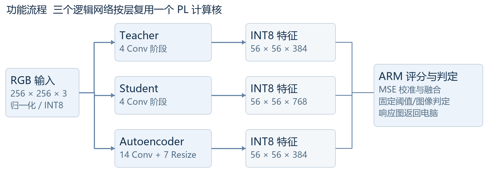
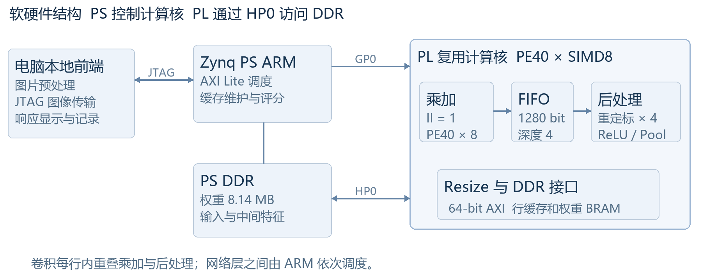
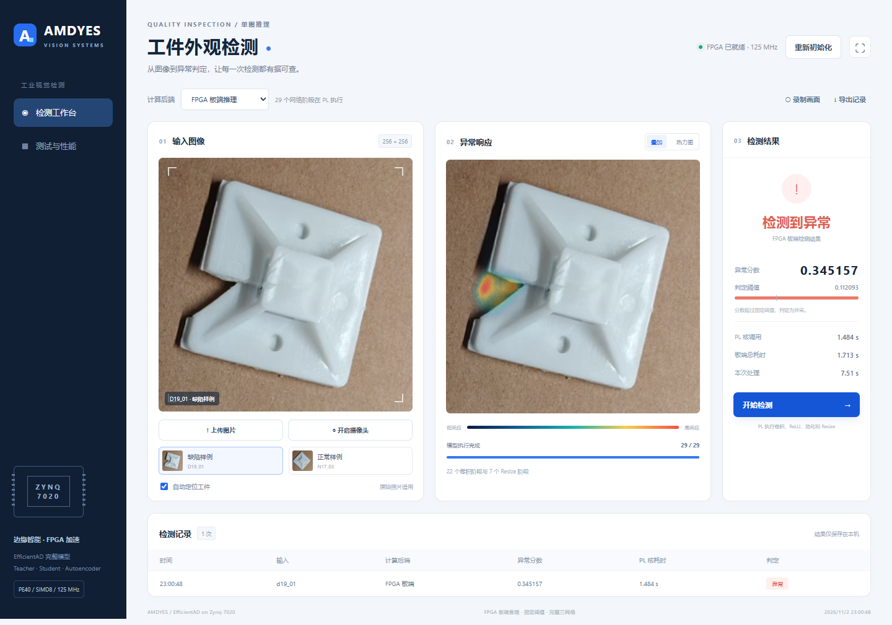

# 基于 Zynq7020 的工件外观异常检测系统设计报告初稿

AMDYES  2026年11月2日

## 1 项目概述

作品名称为基于 FPGA 的工件外观检测系统，参赛方向为 AMD 自主选题赛道。本初稿以团队提供的选题指南第 3.3 节和第六节为依据，围绕完整模型部署、工程优化与可复现证据组织。团队名称为 AMDYES；学校、成员、指导教师、报名组别及板卡修订以团队最终审核信息为准。

系统面向固定照明和俯拍条件下的白色尼龙扎带固定座，输出图像级异常分数、合格判定、异常响应图和检测记录。模型采用已冻结的 EfficientAD Teacher、Student 和 Autoencoder，22 个卷积阶段及其激活、平均池化和 7 个 Resize 阶段由 PL 执行，ARM 负责调度与最终评分。

| 当前已验证项目 | 实测或检查结果 |
|---|---|
| 目标工程与工具 | xc7z020clg484-2；Vivado / Vitis 2025.2 |
| PL 时钟及布线时序 | 125 MHz；WNS +0.175 ns；WHS +0.038 ns |
| 核调用 / 含自检总耗时 | 约 1.484 s / 2.028 s 每图 |
| 演示服务板端耗时 | 约 1.713 s 每图，不含 JTAG 图像传输 |
| 硬件资源 | 25,750 LUT；33,207 FF；203 DSP；57 BRAM36 |
| 正确性 | 31 组 C/RTL；两图 58 个阶段 CRC；上传完整响应图逐像素一致 |
主要结论是：完整三网络已在该小型 SoC 上完成部署；后处理重叠在 DSP 与 BRAM 数量不变时，使 PE40 版核调用耗时降低 17.0%。本次对收到的284张裁剪图重新评估，并将排除标定组后的75张留出图上板核对。早期33张裁剪图INT8准确率96.97%，扩批48张降至66.67%，不能据早期结果声称现场可靠性。

## 2 选题背景与设计价值

小批量工件的缺角、外缘缺损或内部结构破损，可能只占图像中的局部区域。正常样本较容易获得，而缺陷样本与像素标注成本较高。使用正常分布学习的异常检测模型，可以作为规则工件外观筛查的一条路线；但模型仍受照明、姿态、背景和定位稳定性影响，不能从实验样例直接推断工业现场可靠性。

EfficientAD 原论文利用轻量特征提取器和教师学生特征差异检测异常，并通过自动编码器补充全局结构信息 [2]。本工程使用其非官方候选实现的冻结训练包，而非声称复现论文全部训练条件或所有公开数据集成绩。论文 GPU 延迟与本板的器件、数值精度及计时口径不同，不作直接性能对照。

本作品的工程价值集中在资源受限条件下的完整部署：将较大的三网络计算统一为动态 HLS 运算核，以 DDR 保存权重与中间特征，通过行缓存、DSP 配对乘法、受限位宽地址通路和任务重叠提高利用率。创新点属于可复现的软硬件实现与系统集成，不把原 EfficientAD 算法或 AMD 现成 IP 声称为本队原创。

相较只演示单个算子，本系统保留模型的全部三网络与最终异常评分，并提供真实图片上传、板端响应图和计时。固定阈值、分组数据清单、拒识记录和明确的后端标识，使功能正确性、识别有效性与演示效果可以分别核查。

## 3 模型来源与数值实现

冻结包标识为 tie_mount_20261026_3000step_dedupval。Teacher、Student、Autoencoder 权重以及 normalization.npz、summary.json 五文件按交接清单逐一核验 SHA256。候选代码提交为 fcab5146f84ae17597044ad5ddf1656ccf805401；本次没有重新训练，也没有根据测试结果更改模型、归一化统计或 0.11209306865930557 的判定阈值。

| 网络 | PL 阶段 | 最终特征 |
|---|---|---|
| Teacher | 4 Conv，含相应 ReLU / AvgPool | 56 × 56 × 384 |
| Student | 4 Conv，含相应 ReLU / AvgPool | 56 × 56 × 768 |
| Autoencoder | 14 Conv 与 7 双线性 Resize | 56 × 56 × 384 |
输入先调整为 256 × 256 RGB，再使用 ImageNet 均值和标准差归一化。部署采用对称 INT8 权重与激活，INT32 偏置和累加，每输出通道使用 Q30 乘数重定标，半数舍入远离零，饱和范围为 -127 至 127。池化对已量化的四个值求和后按同样的舍入约定除以四；Resize 使用冻结 Q15 坐标权重。输入在 HWC 内存布局中填充至 8 通道，其余网络通道按八字节字打包。

本次 INT8 激活范围来自 D19_01 和 N17_03 两图的 FP32 激活最大绝对值并保留 5% 余量。这是便于部署验证的标定方式，不是充分的生产量化校准。由于这两个实物组参与标定，后续独立 INT8 精度评估需要整体排除 D19、N17，而不是只排除对应的两张照片。

ARM 将教师特征按冻结均值和标准差归一化，分别计算教师学生分支与自动编码器分支的通道平均平方差，按冻结分位数校准并融合；融合响应图补边后由 64 × 64 双线性恢复为 256 × 256，最大值作为图像级分数。异常响应图是模型输出，不等于像素标注准确率或已验证的缺陷检测框。

## 4 软硬件划分与接口

PS 使用约 666.667 MHz 的 Cortex A9 core 0，负责逐层配置、缓存维护、三网络特征保存及最终浮点评分。PL 只有一个可复用计算核，各网络层以寄存器参数和 DDR 地址依次调用，不需要每层重新配置 bitstream。当前 DDR 权重和参数约 8.14 MB，输入与中间特征预先或按请求放入 DDR。

| 接口或地址 | 定义 |
|---|---|
| GP0 AXI Lite | PS 控制，计算核基址 0x43C00000 |
| PL M_AXI / PS S_AXI_HP0 | PL 直接访问 PS DDR，64-bit 数据、32-bit 字节地址 |
| 0x00 / 0x10 | 启动与完成状态 / 返回状态码 |
| 0x18 / 0x28 | AXI 内存基址设为零 / 卷积或 Resize 操作码 |
| 0x30 至 0x50 | 输入、输出、权重、偏置与乘数地址，按 64-bit 字索引 |
| 0x58 至 0xA8 / 0xB0 | 形状、步长、填充、激活、池化及输出尺寸 / Resize 坐标 |
PS 在运算前清理输入与输出缓存，在 PL 完成后失效输出缓存，避免读到旧数据。演示模式通过 JTAG 将 524288 字节量化输入写入 DDR，再使用请求序号和完成序号握手；板端返回融合图、分数与 29 阶段时间。JTAG 只传输数据，不替代网络计算。复用的现成 IP 包括 PS7、AXI SmartConnect、Processor System Reset 与 XL Constant。

## 5 优化过程与实测对比

优化以冻结模型、量化参数与同两张输入为前提。先通过位宽约束、缓存和调度改善计算，再逐步提高时钟；每轮保留独立版本并建立新 RTL 的 C/RTL、实现时序和板测证据。表 2 由现存逐层 JSON 与实现报告重新汇总，历史版本没有在本次全部重新运行。

| 版本 | 频率 | 核调用 | 含自检 | DSP | BRAM36 |
|---|---|---|---|---|---|
| packed50 | 50 MHz | 4.507 s | 5.041 s | 208 | 49 |
| addr75 | 75 MHz | 3.068 s | 3.608 s | 175 | 49 |
| ctrl100 | 100 MHz | 2.319 s | 2.859 s | 175 | 49 |
| pipe125 | 125 MHz | 1.898 s | 2.442 s | 171 | 49 |
| pe40 | 125 MHz | 1.787 s | 2.332 s | 203 | 57 |
| overlap125 | 125 MHz | 1.484 s | 2.028 s | 203 | 57 |
地址重构限制形状乘法和地址中间值宽度，减少不必要的大位宽乘法器；控制扇出与物理优化为提频创造条件。125 MHz 流水版保持 PE32，随后 PE40 将理论峰值从 256 增至 320 个 INT8 MAC 每拍，但通道多为 32 的倍数，额外补齐与后处理使实际核耗时仅下降 5.8%，两个首层还从各 117.488 ms 增至 132.240 ms。并行度增幅不能直接作为整网提速。

后处理重叠版将每行分为乘加生产者与重定标、池化、写回消费者，用 1280-bit、深度 4 的 LUTRAM FIFO 传递累加结果。每行结束排空后才更新行缓存；乘加 II=1，仍只有四路重定标。本轮 PE40 核耗时由 1.787 s 降至 1.484 s，减少 17.0%；DSP203、BRAM36数量57保持不变，LUT从23599增至25750，FF从27105增至33207。

| 同一输入与数值规则 | 算子调用合计 | 含自检完整流程 |
|---|---|---|
| 单核 ARM NEON O3 | 32.157 s | 32.607 s |
| 当前 PL 重叠版 | 1.484 s | 2.028 s |
| 当前相对该 ARM 实现 | 约 21.68 倍 | 约 16.08 倍 |
ARM 基线开启 I/D cache，使用 NEON 的四空间位置乘两输出通道分块；这不是双核或所有高性能软件库的上限。上述计时均不含图像采集、解码或 JTAG 下载。当前演示服务省略逐层 CRC 后板端约 1.713 s；这是另一计时范围，不能与含自检数据混作同一指标。

## 6 功能验证与识别统计

功能验证分层进行：C 测试确认数值规则；31 组新 RTL 的 C/RTL 对照覆盖多种卷积、池化、Resize、边界尺寸与不足 40 输出通道；综合、打包、仿真与 Vivado 导入内容通过哈希一致性核对。布线后 125 MHz 时钟约束满足 setup 和 hold。两张整图共 58 个阶段 CRC 与冻结 golden 一致，最终分数不变。

| 图片 | FP32 本次分数 | INT8 及板端分数 | 阈值判定 |
|---|---|---|---|
| D19_01 | 0.320080310 | 0.345157206 | 异常 |
| N17_03 | 0.065857850 | 0.073264331 | 正常 |
新增持久 PS 服务接受实际上传的量化图像，再返回板上融合图。两张样例的完整 256 × 256 异常响应图与整数参考逐像素一致，最大绝对误差为零。本次 PC 参考运行环境为 RTX 5070 Laptop GPU；其处理时间只用于参考计算，不能填入 FPGA 性能栏。

| 历史 FP32 数据范围 | 判对及拒识 | 准确率 | AUROC |
|---|---|---|---|
| 开发集评分表 | 43 / 48；无拒识 | 89.58% | 96.25% |
| 留出表成功定位子集 | 32 / 33 | 96.97% | 100.00% |
| 留出表全流程 | 32 正确，1 误报，2 定位失败 / 35 | 自动正确处理 91.43% | 不对拒识强算 AUC |
以上早期统计由既有CSV重算，并已用本次收到的48张开发裁剪图和33张留出裁剪图重新运行FP32核对，逐图分数误差不超过1.2×10⁻⁷。开发集TP36、FN4、TN7、FP1；早期留出裁剪图TP20、FN0、TN12、FP1，误报为N20_01。

原35张留出原图中的N17_02、N19_01曾被定位器拒绝，原图未随本次交接提供，故定位失败率只沿用历史记录，不冒称重新测试全流程。已收到的裁剪图不用于重复验证定位器；同一实物多视角图片不等于独立实物。本工程缺少可靠像素标注，不报告像素定位准确率。

## 7 本次识别精度与量化评估

新增交接目录包含四组共284张256×256裁剪图，去重后224种文件哈希。逐图核对input_manifest.csv后，用冻结权重、原归一化统计及固定阈值0.112093重跑FP32和部署INT8参考。交接说明明确这些图片已参与方法排查，因此以下是回顾性评估，不是新的独立盲测；四组之间有重复和不同裁剪版本，不能合并成284张独立测试集。

| 数据组 | 图片数 | FP32准确率 | INT8准确率 | INT8 AUROC |
|---|---|---|---|---|
| 早期开发 | 48 | 89.58% | 93.75% | 96.88% |
| 早期留出裁剪 | 33 | 96.97% | 96.97% | 100.00% |
| 扩批开发 | 155 | 79.35% | 81.94% | 60.35% |
| 扩批留出 | 48 | 68.75% | 66.67% | 74.02% |
扩批48张由32张缺陷和16张正常组成。FP32判对33/48，TP32、FN0、TN1、FP15；INT8判对32/48，TP32、FN0、TN0、FP16。INT8召回率100%，正常件特异度0%，F1为0.800，说明高误报是当前部署的主要缺口。FP32本身也大量误报，不能把问题全部归因于量化。测试期间没有根据这些结果调整阈值或权重。

| 实际上板子集（排除D19/N17） | 图片数 | 判对 | 准确率 |
|---|---|---|---|
| 早期留出裁剪 | 27 | 26 / 27 | 96.30% |
| 扩批留出 | 48 | 32 / 48 | 66.67% |
75张实际输入在板上执行完整三网络，完整256×256异常响应图与整数参考的最大绝对误差为0。这说明已测数据上的硬件实现与量化参考一致；不能把数值一致性写成识别准确率100%。未参与训练或方法排查的新实物盲测仍待采集。

扩批CSV同时存有旧模型old_score与另一模型new_score；当前冻结部署包对应old_score/old_threshold。早期CSV对应new_score/new_threshold。按版本区分后，FP32重推理与相应历史分数最大误差不超过1.2×10⁻⁷。逐图分数、混淆矩阵、误报漏报、文件哈希及板测结果位于sim/results/received_accuracy/。

## 8 演示前端与实际操作

本地服务仅监听 127.0.0.1。默认选择真实 FPGA 后端，初始化后将图片量化、上传至 DDR，由板端执行完整三网络并返回结果。界面显示输入、异常响应、固定阈值、判定、模型进度和历史，可切换叠加图与热力图，导出带后端标识的 CSV。电脑 FP32 与 INT8 参考模式明确标识，不混充板端执行。

浏览器自动化已验证真实 FPGA 缺陷与正常样例、文件上传、软件参考、导出和窄屏布局，未出现 JavaScript 错误。摄像头取景、单帧拍摄、拍摄模式及本地 WebM 录制入口已实现；物理摄像头和屏幕共享必须由用户点击授权并现场确认，自动测试没有替用户采集个人画面。完整拍摄顺序见 video_script.md。

## 9 大模型协作与技能提炼

协作采用 OpenAI Codex，围绕真实工程和工具反馈推进。交互记录保留实际用户提示词、回答节选、失败现象与修复证据，而非只留下成功结论。工具使用顺序为读取源码和逐层计时、提出受控改动、独立实现、C 测试、C/RTL、时序和身份检查、板测、封存；本工程不声称实现了另一个本地智能体赛道的容器评测方案。

| 真实观察或失败 | 纠正与验证 |
|---|---|
| 并行度增加但速度收益小 | 读取逐层耗时，识别补齐和后处理，转而尝试任务重叠 |
| 1280-bit 超默认位宽上限 | 调整私有 HLS 类型上限，31组 C 测试重新通过 |
| 浅宽 FIFO 占用过多 BRAM及依赖警告 | 显式 LUTRAM，池化状态留在消费者；新 RTL 与时序通过 |
| 导出自动加入仿真死锁检测代码 | 只接受已识别的工具附加代码，保持仿真与打包字节相同 |
| JTAG 目标发现与二进制传输参数差异 | 等待指定序列号，明确字数；上传异常图逐像素通过 |
| 两图通过与准确率概念混淆 | 将标定图一致性、历史统计和独立精度分别记录 |
从这些观察中提炼出可复用技能：通用文件哈希校验、Vivado setup/hold 读取、受控优化提示词工作流和失败清单。脚本没有绑定本模型的网络层，可替换清单用于其他设计。五项正反例覆盖正确哈希、内容变化、越界路径、正 slack 与负 slack，实际验证通过。

技能包同时注明边界：哈希不能证明参考正确，时序解析不能证明约束完整，C/RTL不等于板测，两图也不等于独立精度。当前未实现并验证通用 PYNQ Overlay，因此不申请或暗示该项加分。实际对话摘录与定位记录见 ai_collaboration.md；每项技能的用法与失效条件见 skill/README.md。

## 10 复现步骤与工程交付

| 目录 | 主要交付 |
|---|---|
| src | 冻结 HLS 与PS自检源码；原模型参考；PS演示服务；本地前后端 |
| sim | C/RTL日志、黄金比对、准确率脚本和历史重算、网页与上传图验证 |
| build | 重建、原生IP恢复、交付审计、资源时序及各版本优化记录 |
| board | bit、ELF、XSA、已布线checkpoint、IP归档、上板脚本与证据 |
| data | 模型/校准、样例、划分评分表、竞赛指南、身份清单 |
| skill 与 report | 可复用方法与校验；设计报告、复现、协作、拍摄说明 |
第一步核对 data/submission_manifest.json 和模型哈希，运行 build/verify_delivery.py、sim/test_delivery_tools.py。使用 build/restore_prebuilt.py 可从原生 IP 归档还原已通过验证的文件，用于检查；这一步不是重新综合。Vivado 可通过 board/view_implemented.cmd 查看交付 checkpoint。

第二步按 reproduction.md 建立 Python 3.11 参考环境。新硬件构建使用 Vivado/Vitis 2025.2，并从交付 XSA 在 Vitis 创建 ps7_cortexa9_0 standalone 平台，Build 后将 EA_BSP 指向相应域目录。设置 EA_PYTHON 和必要工具路径后执行 build/rebuild.cmd，从源代码重新执行 C、HLS、31组 C/RTL、Vivado 实现和 PS 自检编译。新工程保存在独立构建目录，不改原 D 盘工程。

第三步接原配电源与 JTAG，核对脚本中的 Digilent 序列号。先运行完整板端自检，再双击 start_demo.cmd，用真实 FPGA 后端上传图片。前端支持电脑参考便于定位数值差异。更换板卡、时钟、模型、量化或接口时，不得直接沿用旧 golden、旧时序或旧板测截图。

第四步运行sim/evaluate_received_inputs.py --board-heldout复现本次284张回顾性评估和75张板测。对另行采集的新盲测图片，运行sim/evaluate_accuracy.py并提供实物分组标签；脚本排除D19、N17标定组。定位失败须另记拒识和覆盖率。不能将同一组反复排查后的图片重新命名为盲测。

所有手工维护的提交文件采用小写英文命名，README.md 按指南示例保留；工具原生生成名称保留在归档或被忽略的构建工作目录内。第三方库许可证与来源独立登记，自有代码沿用 MIT。此次只整理本地文件，没有代替团队执行公开推送或比赛提交。

## 11 结论与待完成事项

本阶段已完成冻结 EfficientAD 三网络在 Zynq7020 上的完整硬件计算链、独立的可复现交付目录和本地演示前端。PE40 后处理重叠版在125 MHz下取得1.484 s核调用、2.028 s含自检总耗时，演示服务省略逐层CRC后约1.713 s。两张上传图的完整响应图与整数参考逐像素相同，体现了接口与数值实现的可核验性。

本次扩批48张INT8准确率为66.67%，正常件16张全部误报，尚不能宣称工业现场可靠性或实时视频帧率。下一步应在独立验证集上排查数据分布和正常化、量化标定及阈值，再采集未见实物盲测；任何改动都应重新建立数值和板测证据。板卡修订、团队身份、现场相机与录屏仍需最终核验。

| 最终提交前事项 | 当前状态 |
|---|---|
| 新实物盲测与误报改进 | 284张回顾测试与75张板测完成；扩批正常误报仍需改进 |
| 官方一页英文 PPT 海报 | 未收到模板；已备无队伍信息的英文内容草稿 |
| 报名、年级学历、板卡修订、最终评分细则 | 由团队核对并填写；不猜测官方截止时间 |
| 现场展示视频 | 前端和拍摄脚本已备，物理拍摄与授权验证待完成 |
| 公开仓库同步与最终提交 | 本次未执行，先由团队复核内容与授权 |
主要参考资料

[1] 团队提供的 2026 AMD 选题指南，第3.3节与第六节。
[[2] Batzner 等，EfficientAD，WACV 2024，128至138页。](https://openaccess.thecvf.com/content/WACV2024/html/Batzner_EfficientAD_Accurate_Visual_Anomaly_Detection_at_Millisecond-Level_Latencies_WACV_2024_paper.html)
[[3] nelson1425 EfficientAD 候选实现，固定提交 fcab5146。](https://github.com/nelson1425/EfficientAD/tree/fcab5146f84ae17597044ad5ddf1656ccf805401)
[[4] Xilinx FINN HLS Library mac.hpp，BSD 3 Clause。](https://github.com/Xilinx/finn-hlslib/blob/master/mac.hpp)
[[5] AMD UG1399 2025.2，DATAFLOW 指令。](https://docs.amd.com/r/2025.2-English/ug1399-vitis-hls/pragma-HLS-dataflow)